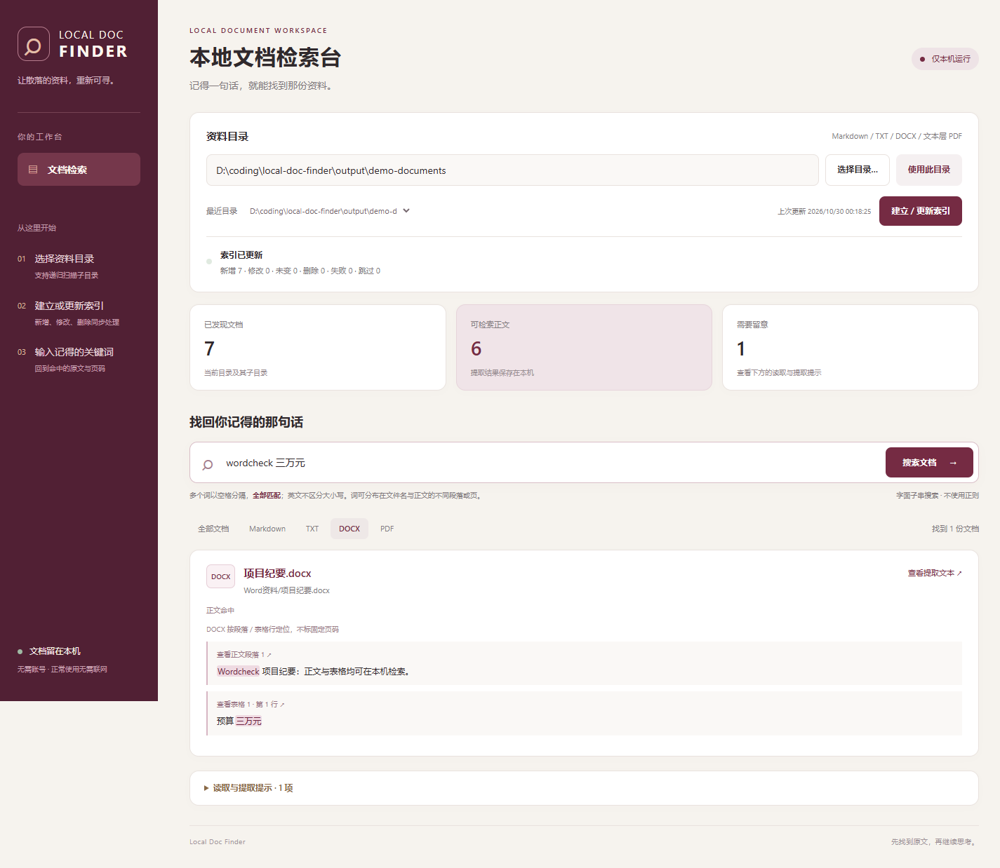
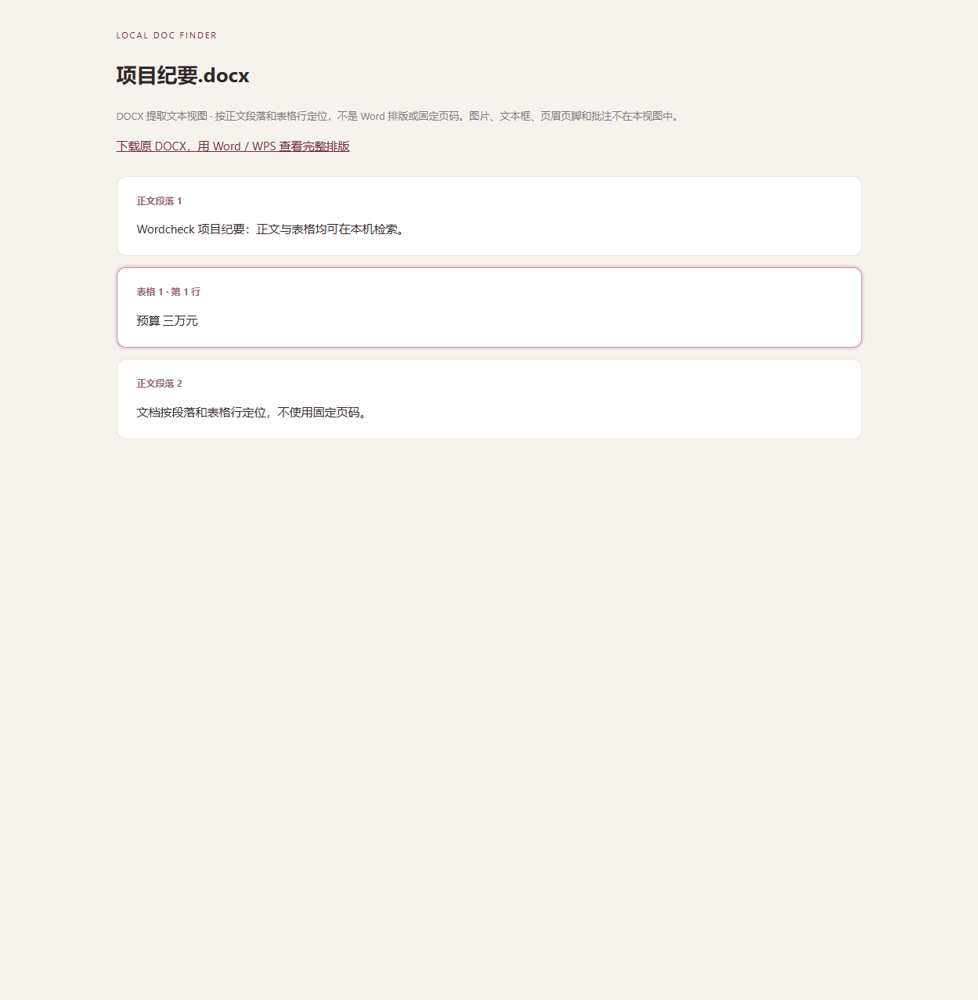

# Local Doc Finder · 本地文档检索台

记得资料里的一句话，却忘了文件名和位置？选择资料目录、建立本地索引，再搜索关键词，查看命中的原文和 PDF 页码或 DOCX 段落 / 表格位置。

这是一个本地网页工具：Python 后端、SQLite 持久索引、原生 HTML/CSS/JavaScript 前端。PDF 使用 pypdf 提取文本，DOCX 通过标准库解包 WordprocessingML；不调用在线服务，也不要求安装 Word。

## 启动

### Windows 桌面软件

前往 [最新版本下载页](https://github.com/XuFugui3411/local-doc-finder/releases/latest)，下载 **LocalDocFinder-1.1.0-windows-x64.zip**。这是包含 Python、pypdf 和网页资源的 Windows 64 位软件包，无需另行安装 Python 或 Word。

1. 将 ZIP 完整解压到桌面或其他目录。
2. 打开解压后的 `LocalDocFinder` 文件夹，双击 **LocalDocFinder.exe**，软件会显示运行管理窗口并自动打开本地网页。
3. 如需桌面图标，右键 EXE → 显示更多选项 → 发送到 → 桌面快捷方式。

请下载 Release 附件中的 Windows ZIP；GitHub 的 **Code → Download ZIP** 和自动生成的 **Source code** 下载的是源码，需要自行配置 Python 环境。

关闭网页标签页后，可在运行管理窗口点“打开检索网页”。点击“退出软件”或关闭运行管理窗口会停止服务并保留索引；若正在提取文档，会先取消未提交的更新并等待当前提取结束。重复启动会复用已有的桌面版服务。

程序目录中的 `LocalDocFinder.exe` 与 `_internal` 文件夹需要放在一起。便携 ZIP 解压后直接运行 EXE 即可；复制单个 EXE 到其他位置无法运行。

### 从源码启动

配置好依赖后，Windows 下双击 **启动文档检索台.cmd**，浏览器会自动打开本地页面。关闭服务控制台或按 Ctrl+C 可停止服务。

运行源码需要 Python 3.11 或以上。首次联网双击 **首次安装依赖.cmd**，或执行：

```powershell
python -m venv .venv
.venv\Scripts\python -m pip install -r requirements.txt
.venv\Scripts\python app.py
```

依赖安装完成后，正常使用无需联网。程序默认监听 `http://127.0.0.1:8766`；端口被占用时自动选择其他空闲本机端口，以控制台打印和自动打开的地址为准。没有云端部署、CDN、远程字体或遥测请求。

## 使用流程

1. 点击 **选择目录**，或粘贴绝对路径后点 **使用此目录**。
2. 点击 **建立 / 更新索引**。会递归处理子目录，显示当前进度、成功更新的统计及读取提示。
3. 输入关键词，按 Enter 或点 **搜索文档**。可按 Markdown、TXT、DOCX、PDF 筛选，并翻页查看结果。
4. 每条结果显示文件名、相对路径、命中原文和高亮。PDF 上下文标注页码，点击可在浏览器中打开原 PDF 对应页；TXT/Markdown 按纯文本打开，避免执行文档中的 HTML。
5. 新增、修改、删除或移动资料后，再点 **建立 / 更新索引**。程序不自动监视文件变化；更新完成前，搜索使用上次已提交的快照。

PDF 页码是从 1 开始的物理页序号，可能与页面上印刷的页码不同。DOCX 的“查看提取文本”在本机打开安全转义的段落 / 表格文字视图，点击定位链接可跳至对应文本块；这不是完整的 Word 排版预览，可从该页面下载原 DOCX 后用 Word / WPS 查看。

PDF 原文跳页依赖浏览器自带 PDF 查看器；若浏览器设置为下载 PDF，可根据结果中的页码自行打开。

## 界面预览

下图使用自动生成的演示资料，展示 DOCX 正文与表格的跨位置关键词匹配。





## 搜索规则

- 以空白字符拆分多个词，**所有词都必须命中同一文档**。例如 `项目 预算` 同时要求“项目”和“预算”。
- 词可以分布在文件名和正文之间，也可以分布在同一 DOCX 的不同段落 / 表格或同一 PDF 的不同页，不要求出现在同一句话或同一页。
- 搜索文件名（不含父目录路径）和正文；相对路径仅用于展示与排序。
- 使用字面子串匹配，不分词，不使用正则、不支持引号短语或 AND/OR 语法。`a+b` 就搜索原样的 `a+b`。
- 英文 ASCII A–Z 不区分大小写；中文原样匹配。不做拼音、繁简转换、Unicode 重音折叠或语义检索。
- 单次最多 200 字符、12 个不同关键词；重复词合并。每页 20 份文档，按相对路径排序。
- 上下文直接截取提取后的文本，保留大小写和换行；每个命中文档最多展示 8 段上下文。PDF 命中页列表保留全部命中页，正文结果不伪造、不改写。
- 无可提取正文或读取失败的文件，仍可按文件名找到；结果明确标注没有正文和相应原因。

## 文档与异常

| 情况 | 本版行为 |
|---|---|
| `.md`、`.markdown`、`.txt` | 支持 UTF-8（含 BOM）、带 BOM 的 UTF-16/32，以及 GB18030；编码失败或疑似二进制时说明原因 |
| `.docx` | 提取主文档正文段落、表格行，保留文本运行拼接、换行和制表符；按正文段落 / 表格行定位，不标固定页码 |
| 有文本层的 PDF | 按页提取原文；排版和阅读顺序取决于 PDF 文本层，不保证复杂表格、多栏或断行与视觉完全一致 |
| 扫描版 PDF / 空白页 | 逐页提示“无可提取文字，可能是扫描页或空白页”；不提供 OCR，不把空白页一律认定为扫描件 |
| 混合 PDF | 可读取的页面继续参与搜索，无文字页面单独提示；页码不重新编号 |
| 加密或损坏 PDF | 明确提示密码或提取失败原因，其他文件继续处理；第一版不提供密码输入 |
| 文件占用、权限不足、读取中变化 | 记录异常，继续处理其他文件；旧正文退出本次已提交索引，避免失效内容继续命中 |
| 子目录无权限 | 提示该目录不可读取；保留其文件名记录、禁用旧正文，不冒充已删除 |
| 整个资料目录不可访问 | 本次更新失败，保留原索引快照，并提示问题 |
| 符号链接 / Windows 目录联接 | 跳过，不跟随到目录外或形成递归环 |
| 已删除或改名的文件 | 更新完成后移除旧记录；新路径重新建立记录 |
| 取消更新 | 当前 PDF / DOCX 任务最多等待约 30 秒（另有子进程清理开销）；未提交的更新回滚 |

跳过 `.git`、`.venv`、`node_modules`、`__pycache__` 及本工具索引数据目录；其他隐藏资料目录正常扫描。不支持旧 `.doc`、`.docm`、Excel 和图片等格式。DOCX 的图片、文本框、页眉页脚、脚注尾注、批注、自动编号标签不参与索引；删除修订忽略、插入修订按保存文字读取，不模拟 Word 最终排版。嵌套表格以外层表格行内的纯文本展开；合并单元格不还原视觉布局。

资源边界：文本文件最多 16 MiB，DOCX 最多 32 MiB（主正文 XML 最多 16 MiB、非空文本块最多 10000 项），PDF 最多 64 MiB / 500 页，单文档提取后最多 200 万字符，单 PDF 页面解压内容流最多 16 MiB。超限时显示原因，不静默截断正文。PDF 和 DOCX 均在独立子进程中提取，等待上限 30 秒，失败不阻塞其他文件。高度压缩或构造异常的 PDF 仍可能消耗大量子进程内存，这不是针对恶意文件的完整沙箱。

## 索引和隐私

- 默认数据位置：Windows 的 `%LOCALAPPDATA%\LocalDocFinder\index.sqlite3`，可能同时出现 SQLite 的 `-wal`、`-shm` 文件。索引存储路径、摘要、提取后的原文和页码，属于本机明文数据。
- 可以用 `python app.py --data-dir D:\我的索引` 更换位置。每个资料目录独立保存索引，最近选择的目录在重启后恢复。旧版索引自动增加定位字段，保留已有内容；增加 DOCX 支持后，需要再点一次更新索引，才会发现目录中的 Word 文档。
- 读取资料，不移动、不改写原文；索引写入发生在数据目录。
- 每次更新会读取支持格式的文件，计算一次 SHA-256；内容未变化时复用已有提取结果。新增、改变或曾经失败的文档重新提取。PDF / DOCX 子进程处理内存中的同一份字节快照，不重复读取原文件。
- 使用 SQLite WAL 和事务。更新期间可查询旧快照，成功后一次提交；取消或整体失败则回滚。首次索引未完成前没有可用正文快照。
- 搜索通过 SQLite `instr` 做子串查询，支持中文但不是倒排全文索引；资料库很大时应单独测量搜索与更新性能。本版没有相关性排序或向量检索。
- 仅监听 IPv4 回环地址，校验 Host / Origin，接口使用每次启动生成的会话令牌；不允许其他网站跨站调用资料接口。原文只允许从已索引的根目录中读取，逐级拒绝链接路径。

关闭服务后如需清除索引，可自行删除所配置的数据目录；这不影响资料原文件。

## 验证与开发

```powershell
.venv\Scripts\python -m unittest discover -s tests -v
```

测试使用临时目录，覆盖递归扫描、中文与空格路径、编码、多词 AND、英文大小写、字面特殊字符、PDF 物理页码及跨页匹配、扫描页、加密和损坏 PDF、真实 Windows 文件占用、目录联接跳过、权限失败、同大小同时间戳的内容变化、索引增删更新、事务回滚、重启持久性、原文范围检查和 HTTP 会话 / 跨站保护。

演示文件可用 `.venv\Scripts\python tools/create_demo.py` 创建到 `output/demo-documents`。它们只是测试内容，不是真实用户资料。浏览器验收截图保存在 `docs/images/`；验收记录见 [VALIDATION.md](VALIDATION.md)。

代码结构：`app.py` 提供本地 HTTP 与后台任务；`indexer.py` 管理 SQLite 和搜索；`extraction.py` 负责编码与隔离 PDF / DOCX 提取，`docx_text.py` 解析 DOCX 正文和表格，`reader.py` 生成安全的提取文本视图；`static/` 是离线网页资源。

## 许可证

本项目代码采用 [MIT](LICENSE)。PDF 提取依赖 [pypdf](https://github.com/py-pdf/pypdf)，使用其自身的 BSD-3-Clause 许可证。

## 构建桌面版

在 Windows x64 上使用 Python 3.11：

```powershell
python -m pip install -r requirements-build.txt
python tools/build_windows.py
```

输出到 `dist/LocalDocFinder/` 和 `releases/`。构建完成后会在去除系统 Python 路径的环境里运行真实 EXE 自检：验证 PDF / DOCX 子进程、DOCX 表格定位、网页静态资源、HTTP 搜索及索引增删更新，通过后才生成 ZIP。
